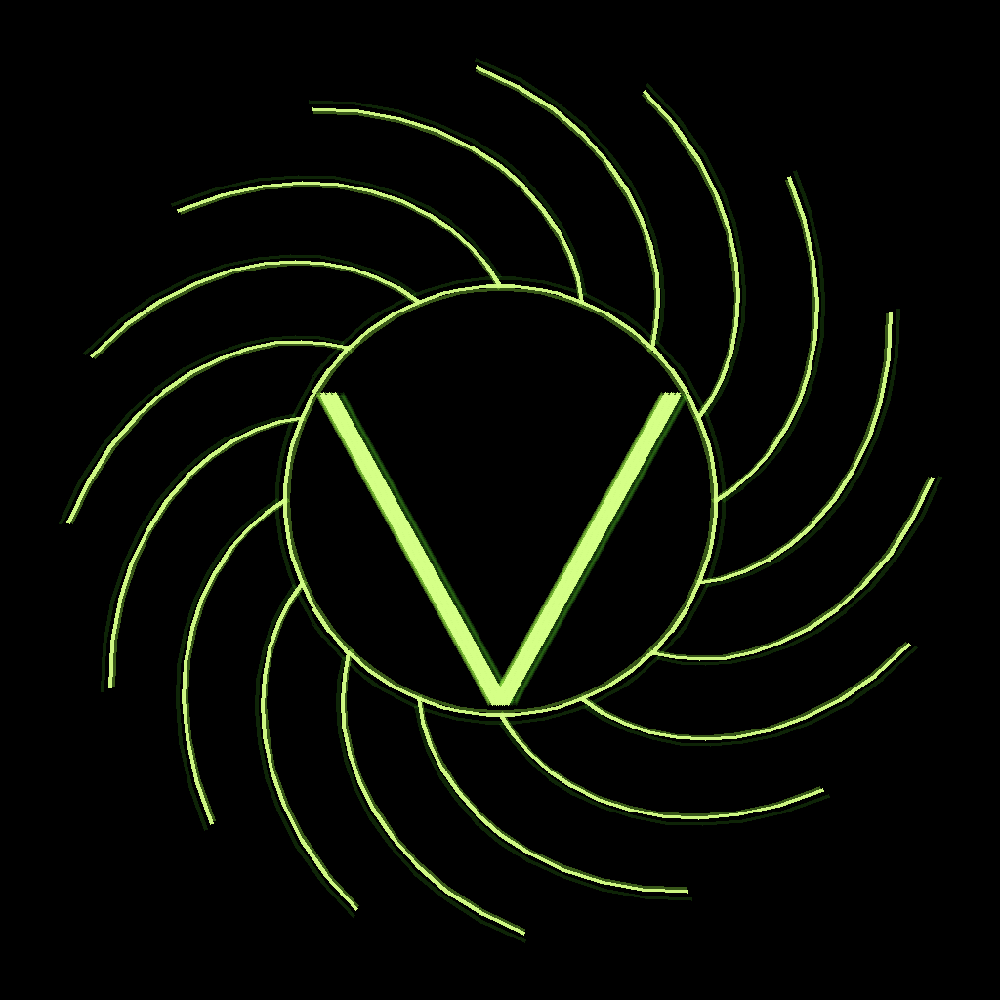

<div align="center">



**Software rendering and audio libraries for first-person games.**

[](https://isocpp.org/)
[](https://cmake.org/)
[](https://www.libsdl.org/)


</div>

---

<div align="center">

## Support the project

If you'd like to support development:

<a href="https://ko-fi.com/xxnukem"></a>

**[ko-fi.com/xxnukem](https://ko-fi.com/xxnukem)**

</div>

---

## Overview

Vortex Engine is a set of C++17 libraries for software-rendered first-person games. It began as the rendering and audio code developed for [Extremis RE](https://github.com/xXNukem/Extremis-RE), an independent reconstruction of the DOS game *In Extremis*.

The engine is maintained separately from the game so that its rendering and audio systems can be reused in other projects. Vortex handles scene rendering and PCM playback; the application supplies its own world data, assets, gameplay rules, input and user interface.

Vortex is **not a complete game framework** or a replacement for the original logic of any supported game. Its interfaces are still evolving as the code is separated from Extremis RE and exercised by independent consumers.

## Libraries

| CMake target | Description | Dependencies |
|:--|:--|:--|
| `Vortex::CPU` | CPU first-person renderer: raycasting, textured walls, floors and ceilings, sprite rendering, depth/occlusion and optional fisheye processing. | C++17 |
| `Vortex::Audio` | PCM audio mixer with multiple voices, gain control, looping and volume ramps. | C++17 |
| `Vortex::AudioSDL` | SDL3 output backend for audio produced by the mixer. | `Vortex::Audio`, SDL3 |

The renderer writes to a CPU framebuffer. Presenting that framebuffer in a window, and interpreting game-specific maps, materials and resources, remain the responsibility of the host application.

The audio mixer operates on decoded samples. Original game sound formats and gameplay sound events are handled outside Vortex.

## Requirements

- C++17-compatible compiler
- CMake 3.21 or later
- SDL3 development libraries **only** when building the optional `AudioSDL` backend

Development and manual validation have primarily taken place on macOS. Other platforms may require additional testing.

## Building and testing

With SDL3 available:

```sh
cmake -S . -B build/release -DCMAKE_BUILD_TYPE=Release
cmake --build build/release --parallel
ctest --test-dir build/release --output-on-failure
```

To build the renderer and mixer without SDL3:

```sh
cmake -S . -B build/cpu-only \
  -DCMAKE_BUILD_TYPE=Release \
  -DVORTEX_ENABLE_SDL3=OFF
cmake --build build/cpu-only --parallel
ctest --test-dir build/cpu-only --output-on-failure
```

The test suite includes independent consumers for rendering and mixing, plus an SDL3 backend test when that component is enabled. These tests cover the public libraries; they are not a substitute for validation within a complete game.

## Installing and using Vortex

Vortex provides an installable CMake package with exported targets.

```sh
cmake --install build/release --prefix /absolute/path/to/vortex-install
```

Point the consuming project's `CMAKE_PREFIX_PATH` at that installation, then link the components it needs:

```cmake
find_package(Vortex CONFIG REQUIRED COMPONENTS CPU Audio)

target_link_libraries(my_game PRIVATE
    Vortex::CPU
    Vortex::Audio
)
```

If the installation includes the SDL3 backend:

```cmake
find_package(Vortex CONFIG REQUIRED COMPONENTS AudioSDL)
target_link_libraries(my_game PRIVATE Vortex::AudioSDL)
```

An installation built with `VORTEX_ENABLE_SDL3=ON` also needs SDL3 discoverable by CMake when loading its package configuration. To distribute or consume only the CPU renderer and mixer without SDL3, use a build configured with `VORTEX_ENABLE_SDL3=OFF`.

## Technical documentation

The [technical guide](docs/README.md) covers [architecture](docs/architecture.md),
[rendering](docs/rendering.md), [audio](docs/audio.md),
[CMake integration](docs/integration.md) and [tests](docs/testing.md).

## Repository layout

```text
include/vortex/       Public headers
src/vortex/           Library implementations and CMake targets
tests/vortex/         Standalone renderer and audio consumers
cmake/                CMake package configuration
```

## Scope and development

The current implementation reflects the requirements of Extremis RE. In particular, it provides a raycasting-based first-person renderer rather than a general-purpose polygonal 3D renderer.

Future work will be driven by real integration requirements and compatibility testing. No stable API or compatibility guarantee is claimed at this stage.

## Related project

[**Extremis RE**](https://github.com/xXNukem/Extremis-RE) is the first project built around these systems. Its DOS resource readers, gameplay implementation, cinematics and other game-specific components are not part of Vortex Engine.

## License and credits

Vortex Engine is released under the [MIT License](LICENSE).

**Development and maintenance:** Carlos de la Barrera Pérez ([xXNukem](https://github.com/xXNukem)).

*In Extremis* and its original assets belong to their respective rights holders. No original game assets are distributed with Vortex Engine.
